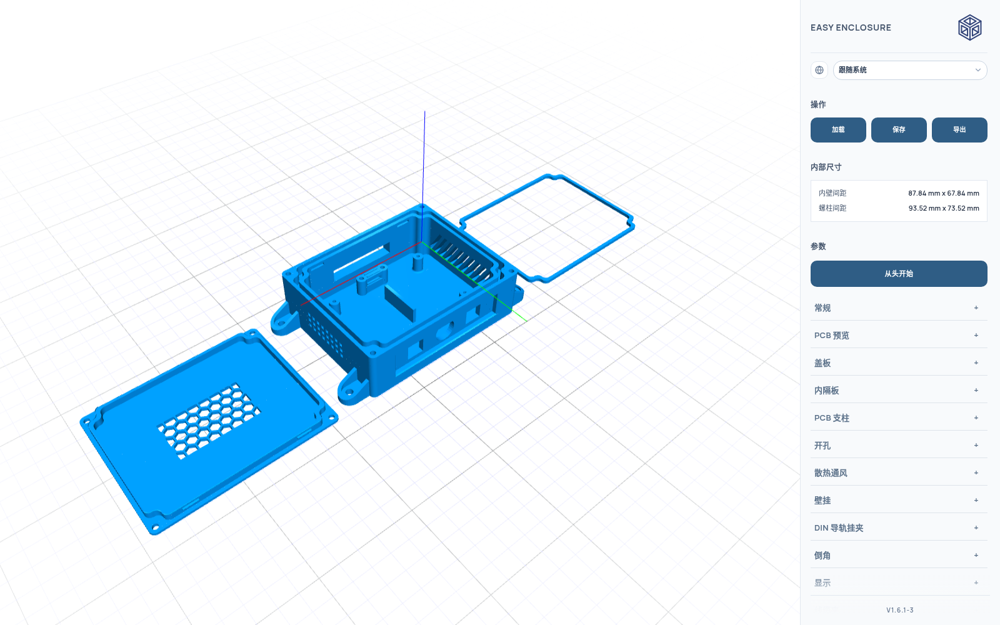

# Easy Enclosure（中文化增强版）



Easy Enclosure 是一款专为 **3D 打印外壳**设计的开源参数化建模工具。界面直观、参数即调即见，
即使没有任何三维建模经验，也能为自己的电子项目、原型或 DIY 小玩意生成可直接打印的外壳。

本仓库是 [bruceborrett/easy-enclosure](https://github.com/bruceborrett/easy-enclosure) 的
**中文化增强分支**：基座取自上游 `main`，再逐项叠加中文界面与几何增强，保持可以持续合并上游改进。

需要说明的是，**倒角、高强度 PCB 支柱、PCB 预览、卡扣**这四项功能最早出自本项目，
后来被上游取用并纳入其 `main`。因为基座同步自上游，本分支现在与上游共用同一套实现，
代码层面一致 —— 但它们是本项目的原创成果，不是从上游继承来的（详见下节）。

### **[在线试用](https://536338958.github.io/easy-enclosure/)**

## 相对上游的改动

### 已被上游取用的功能

| 功能 | 说明 |
|---|---|
| **倒角** | 基座底边 / 盖板底边 / 嵌入边顶端三处可独立调参（默认 0.6 / 0.6 / 0.4mm）。底边倒角改善首层贴合、便于脱板，嵌入边顶端倒角给盖板装配做导入导向 |
| **高强度 PCB 支柱** | 根部 360° 环形凹圆角，半径按支柱外径自动配比（外径的 1/3，并钳制在柱高的 45% 以内），消除直角缺口，抵抗侧向剪切与拧紧扭矩 |
| **PCB 预览** | 按长 / 宽 / 厚 + 元件净空高度在 3D 视口里画出 PCB 占位体，底面自动落在底板支柱顶端，实时碰撞检测，撞到侧壁 / 内隔板 / 盖板时变红报警 |
| **卡扣（免螺丝盖板）** | 沿盖板嵌入边挤出的横向定位珠，卡进底壳内壁凹槽；4 / 6 / 8 扣可选，珠宽、凸出深度、珠高、配合间隙均可调，凸出深度自动钳制在壁厚的 80% 以内 |

### 中英双语界面

上游没有任何 i18n，本分支从零搭了一套：

- 界面语言可切换：**跟随系统 / 中文 / English**，选择持久化到 localStorage
- 词条表是 TypeScript **联合类型**，模板里写错键会在 `ng build` 的模板类型检查阶段
  直接编译失败，漏翻无处藏身
- 插值用 `{name}` 占位符，缺变量时原样保留，便于发现漏传

### 散热通风槽（上游没有的概念）

外壳六个面（顶 / 底 / 前 / 后 / 左 / 右）都可以单独开通风结构，四种样式可选：

| 样式 | 说明 |
|---|---|
| 圆角长槽 | 两圆柱 `hull` 出来的长圆孔，散热面积最大 |
| 圆孔阵列 | 规则网格排布 |
| 方孔阵列 | 规则网格排布 |
| **六边形蜂窝** | 正六棱柱孔的蜂窝排布，同面积下开孔率最高、结构最匀称 |

孔径、间距、行列数、边距均可调；墙面通风槽沿厚度方向穿透，并与墙面网格行数参数联动。

### 参数级特性

- **显示坐标轴**（`showAxes`）：视口里叠加三轴指示
- **挂耳切角角度**：上游写死 45°，本分支开放为参数（默认 60°）
- **螺丝孔位**：盖板螺丝的分布方式可选

### 几何修复

- **开孔贯穿余量**：修复侧面 / 底面开孔切不透、留一层皮的问题
- **挂耳底边倒角**：修复倒角在挂耳圆端断裂的问题
- **内腔地板基准**：修复关闭盖板螺丝时内隔板悬空 1.5mm（或陷入实体地板 2mm+）的问题，
  四种「盖板螺丝 × 防水」组合实测全部对齐

- **嵌入边与内腔四角失配**：壁厚增大时底壳内腔四角的圆角会塌成尖角，而盖板嵌入边
  仍是原来的大圆角，角部间隙从 0.04mm 涨到 0.9mm。现在嵌入边走真等距内缩，
  四种「盖板螺丝 × 防水」组合、壁厚 1–6mm 实测间隙处处等于装配间隙

### 质量保障

- `npm run verify` —— 几何验证：挂耳切角、内腔地板、嵌入边倒角闭合、切除体积、
  盖板装配（间隙、角部弧度不随壁厚退化、防水槽内圈、3D 干涉）等
- `CHANGELOG.md` —— 按阶段记录每一步改动，附实测数字与判据

## 功能特性（继承自上游）

- 实时 3D 预览
- 导出 STL（网格）与 STEP（实体 CAD）
- 内部线缆夹，带肋条纹防脱 grip，附配套打印绑带
- 参数预设保存 / 加载（JSON）

## 导出格式

支持多种三维交换格式，单文件下载或多零件 ZIP 打包：

- **STL（网格）**：三角面片，供切片软件使用（Cura、PrusaSlicer、Bambu Studio、OrcaSlicer）
- **STEP（实体 CAD）**：ISO-10303-21 (AP214) 面片边界表示，供 CAD 交互使用
  （FreeCAD、Fusion 360、SolidWorks、Onshape）

导出内容可以是完整装配，也可以只选部分零件（底壳、盖板、防水 TPU 密封圈、PCB 支柱、
DIN 导轨夹、线缆夹绑带）。导出注册表（`ExportFormatService`) 可扩展，后续可以加 3MF、OBJ 等。

## 技术栈

TypeScript、Angular、JSCAD

## 开发

### 环境要求

- Node.js 20+
- npm 10+

### 安装

```bash
npm install
```

### 本地运行

```bash
npm run dev
```

启动 Angular 应用，并把 `package.json` 里的版本号同步到界面角标。

### 构建

```bash
npm run build
```

### 测试

```bash
npm test
```

或监视模式：

```bash
npm run test:watch
```

### 几何验证（本分支新增）

```bash
npm run verify
```

只跑几何验证 / 只跑嵌入边倒角验证 / 只跑盖板装配验证 / 性能基准：

```bash
npm run verify:geometry
npm run verify:rim-chamfer
npm run verify:lid-fit
npm run bench
```

### 部署到 GitHub Pages

```bash
npm run deploy
```

发布 `dist/angular-app/browser`。

## 紧固与螺丝策略

盖板与底壳的紧固方式有多种打孔策略，对应不同的五金件：

### 1. 盲孔（自攻螺丝）

- **适合**：紧凑结构、原型、很少拆开的外壳
- **优点**：
  - 占空间最小：角部凸台最小，给 PCB 和元件留出最大内腔
  - 耗材最少、打印最快
  - 底壳底面完全封闭、干净、防水
  - 不需要特殊工具和额外五金（直接拧进打印塑料）
- **缺点**：
  - 反复拆装会磨损塑料螺纹

### 2. 盲孔（热熔铜螺母）

- **适合**：需要频繁拆装、长期耐用的正式外壳
- **优点**：
  - 黄铜机牙螺纹强度高、耐拆装，可无限次装配拆卸
  - 凸台紧凑（比六角螺母槽小，比自攻底孔略大）
  - 底壳底面保持实心、封闭、防水
- **缺点**：
  - 需要铜螺母（如 M3）和电烙铁压入

### 3. 六角螺母槽

- **适合**：用普通五金件实现高强度机牙紧固，且不想动电烙铁
- **优点**：
  - 普通六角螺母 + 机牙螺栓即可实现金属对金属的夹紧
  - 无需压入工具
- **缺点**：
  - 六角螺母需要大得多的角部凸台来保证壁厚，压缩内部空间、耗材更多、打印更久
  - 螺栓长度必须与底壳 + 盖板的合计高度精确匹配
  - 底壳底面会留开口

### 4. 通孔

- **适合**：长螺栓从底部加螺母、支柱安装，或把整个外壳锁到面板上

### 5. 卡扣（免螺丝卡扣盖板）

- **适合**：免工具装配、快拆电池仓、传感器外壳、不想用螺丝的紧凑外壳
- **原理**：沿盖板嵌入边挤出的横向定位珠，卡进底壳内壁上切出的定位凹槽。
  珠的截面用平滑椭圆弧，插入顺滑、保持牢固，且不易沿层间剥离
- **卡扣数量**：
  - **4 扣**（默认）：两条长边各 2 个
  - **6 扣**：两条长边各 2 个 + 两条短边各 1 个居中
  - **8 扣**：四边各 2 个
- **可调参数**：珠宽、凸出深度、珠高、凹槽配合间隙、角部退让比例
- **安全上限**：卡扣凸出深度自动钳制在壁厚的 80% 以内，保证外壁完整。可与角部盖板螺丝并用

### 螺丝头沉孔与盖板厚度

启用螺丝头沉孔（**沉头孔 Counterbore** 或 **埋头孔 Countersunk**）时，沉孔直接开在盖板顶面。
请确保「尺寸」页里的**盖板厚度（`roof`）大于沉孔深度**，留出实心夹持肩：

- **埋头螺丝（DIN 7991 / ISO 10642）**：
  - M3 埋头约 1.7mm 深（90° 锥面）
  - 建议盖板厚度：**2.5 – 3.0mm**，留下 0.8 – 1.3mm 实心塑料承受夹紧力
- **沉头孔（圆柱头螺丝 DIN 912）**：
  - 标准 M3 圆柱头约 3.0mm 高、5.5mm 直径
  - 建议盖板厚度：**4.0 – 4.5mm**，沉孔深度 3.0mm
- **沉头孔（低矮圆头螺丝 ISO 7380）**：
  - 圆头高度只有约 1.65mm
  - 建议盖板厚度：**2.5 – 3.0mm**，沉孔深度 1.7mm

> **提示**：把盖板顶面加厚 1 – 1.5mm 几乎不费耗材（就是一层薄平板），却能让底壳四根
> 竖柱保持紧凑，把内部空间尽量留给 PCB。

### PCB 支柱根部加强

> 本项目原创，后被上游取用。

沿 Z 轴竖直打印的圆柱支柱，在 FDM 打印里第一层与底板 / 盖板交界处应力集中，
拧螺丝的扭矩很容易把它齐根剪断。本软件自动给所有 PCB 支柱加根部圆角：

- **自动比例根部圆角**：360° 环形凹圆角过渡，消除直角缺口，在标准圆形 PCB 禁布环内
  提供对抗侧向剪切和拧紧扭矩的最大各向同性强度。圆角半径按支柱外径自动配比
  （外径的 1/3，例如 6.0mm 支柱配 2.0mm 圆角，并安全钳制在支柱高度的 45% 以内）

### PCB 预览与碰撞检查

> 本项目原创，后被上游取用。

在参数面板打开 PCB 预览后，视口会按长 / 宽 / 厚画出一块 PCB 占位体，用来在打印之前
确认板子放得下、元件顶不到盖板：

- **落位自动**：板底面自动落在底面支柱的顶端（没有支柱时落在内腔地板），不用手算 Z 高度
- **元件净空**：`元件高度` 是板上方元件占用的净空高度，只参与碰撞检测，不画进外形
- **碰撞判定**：与侧壁 / 内隔板相交 → 「板体/元件超出内腔」；元件顶部顶到盖板 →
  「元件顶部顶到盖板」。未碰撞显示绿色，碰撞显示红色并在视口给出提示
- **X / Y 原点**：以底壳中心为原点，与 PCB 支柱一致

### 倒角

> 本项目原创，后被上游取用。

三处倒角各自独立可调（默认 0.6 / 0.6 / 0.4mm）：

| 参数 | 位置 | 作用 |
|---|---|---|
| 基座底边倒角 | 底壳与打印床接触的那一圈 | 缓解首层外扩（象脚）、便于脱板 |
| 盖板底边倒角 | 盖板朝下的那一圈 | 同上 |
| 嵌入边顶端倒角 | 盖板嵌入边的顶端 | 装配导入导向，盖板更容易滑进底壳 |

嵌入边顶端倒角会自动钳制：不超过嵌入高度的 90% 与嵌入壁厚的 80% 中的较小者，
避免倒角把嵌入边切穿。

## 注意事项

- 所有尺寸单位均为毫米（mm）
- 户外使用建议用 PETG 打印
- 防水密封圈用 TPU 打印
- 开孔需要支撑
- 总高 = 底壳高度 + 壁厚
- 内高 = 底壳高度 - 壁厚
- 内宽 = 宽度 - 壁厚 × 2
- 内长 = 长度 - 壁厚 × 2
- 角部螺丝会额外占空间，决定长宽时记得留量
- PCB 支柱的 X / Y 以底壳中心为原点
